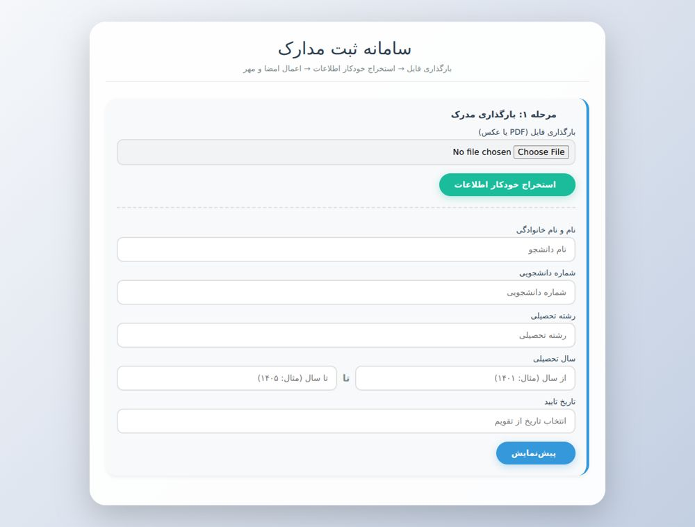

# University document processing demo



A Persian browser-based document workflow for previewing PDFs/images, extracting text with OCR, editing student metadata, applying signature/stamp images, generating QR codes and exporting documents.

## Run locally

Requires Python 3 for the optional static server. From this repository folder:

```bash
python -m http.server 8000
```

Open http://localhost:8000. No deployment is required.

## Repository structure

- `index.html` — page structure
- `styles.css` — responsive styles
- `app.js` — document, storage and export logic
- `.github/workflows/quality.yml` — automated checks
- `docs/` — import provenance and review notes

## Scope and dependencies

This version accepts single-page documents; multi-page PDFs are rejected explicitly. Records use browser localStorage (`universityDB`), not a server database. OCR results need manual review. PDF.js, Tesseract, jsPDF, QRCode and icon resources load from CDNs; the app is not fully offline. Storage failures are reported without advancing the workflow. No official university verification service is connected.

## Validation

Local HTML/CSS asset references and JavaScript syntax are checked during the import. See `docs/VALIDATION.md` for the actual results and limits. CI is defined in `.github/workflows/quality.yml`.

## Source preservation

All original project files were imported in a separate Git commit before changes. `docs/ORIGINAL_FILES.sha256` lists the archive file checksums. Existing images, fonts and notices are retained. No repository-wide license grant has been added.
